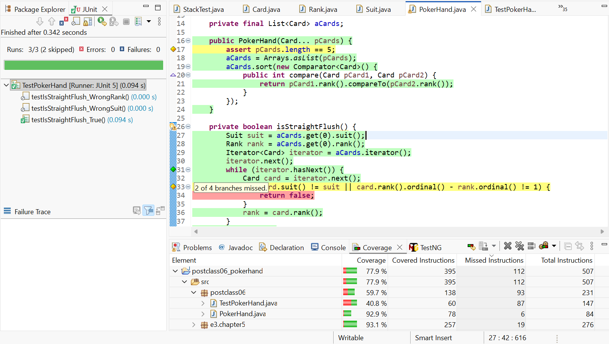
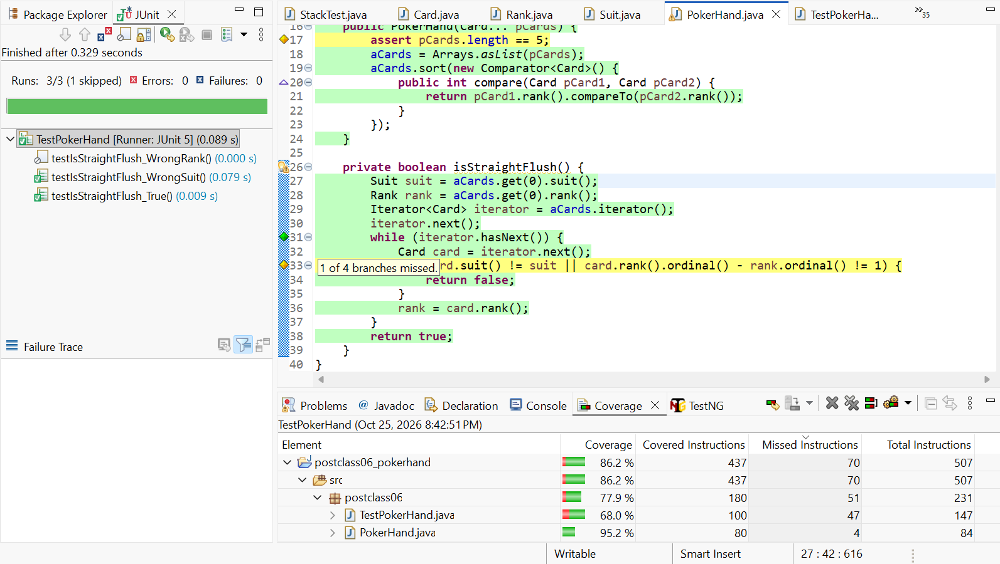
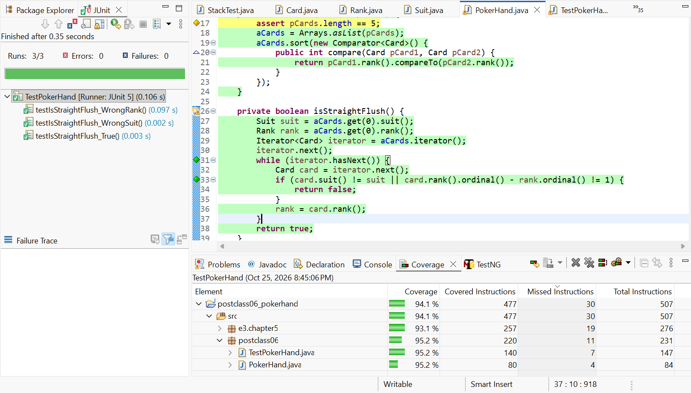

# Post-Class 06 – Exercise 8, 9, 10: Kiểm thử PokerHand và độ phủ

| | |
|---|---|
| **Họ và tên** | Lê Anh Khoa |
| **MSSV** | 4651050119 |
| **Lớp** | 46D |
| **Bài** | Post-Class 06 – Exercise 8, 9, 10 (Chapter 5, *Introduction to Software Design with Java*) |

---

## 1. Đề bài

Cả ba bài cùng làm việc trên lớp `PokerHand` (lời giải một phần của Exercise 3.12), cụ thể là phương thức private `isStraightFlush`.

> **Exercise 8:** Viết lớp test `TestPokerHand` có các hàm trợ giúp để test được phương thức private `isStraightFlush`, rồi viết một test case cho kết quả `true`. Cần bao nhiêu lần chạy UUT để test với mọi sảnh đồng chất (straight flush) có thể có? Điều đó có nghĩa là đạt độ phủ vét cạn (exhaustive) không?
>
> **Exercise 9:** Mở rộng bộ test của `PokerHand` để đạt **statement coverage** hoàn toàn với số lần chạy UUT ít nhất.
>
> **Exercise 10:** Mở rộng bộ test của `PokerHand` để đạt **branch coverage** hoàn toàn với số lần chạy UUT ít nhất.

Yêu cầu của Post-Class: **thực hành và giải thích giải pháp** của các bài 5.8, 5.9, 5.10.

---

## 2. Lớp cần kiểm thử

`isStraightFlush` duyệt các lá bài (đã sắp theo rank) và trả về `false` ngay khi gặp một lá khác chất hoặc rank không liên tiếp, nếu không thì trả về `true`:

```java
private boolean isStraightFlush() {
	Suit suit = aCards.get(0).suit();
	Rank rank = aCards.get(0).rank();
	Iterator<Card> iterator = aCards.iterator();
	iterator.next();
	while (iterator.hasNext()) {
		Card card = iterator.next();
		if (card.suit() != suit || card.rank().ordinal() - rank.ordinal() != 1) {
			return false;
		}
		rank = card.rank();
	}
	return true;
}
```

Đề và lời giải mẫu dùng `getRank()` và `getSuit()` của ấn bản cũ. Lớp `Card` ở ấn bản 3 đã đổi tên thành `rank()` và `suit()`, nên em sửa lại cho khớp, logic giữ nguyên.

---

## 3. Mã nguồn bộ test

```java
package postclass06;

import static org.junit.jupiter.api.Assertions.assertFalse;
import static org.junit.jupiter.api.Assertions.assertTrue;
import static org.junit.jupiter.api.Assertions.fail;

import java.lang.reflect.Method;

import org.junit.jupiter.api.Test;

import e3.chapter5.Card;
import e3.chapter5.Rank;
import e3.chapter5.Suit;

public class TestPokerHand {

	// Hàm trợ giúp: dùng Reflection để gọi phương thức private isStraightFlush
	private static boolean invokeIsStraightFlush(PokerHand pHand) {
		try {
			Method method = PokerHand.class.getDeclaredMethod("isStraightFlush");
			method.setAccessible(true);
			return (boolean) method.invoke(pHand);
		} catch (ReflectiveOperationException e) {
			e.printStackTrace();
			fail();
			return false;
		}
	}

	// Exercise 8: sảnh đồng chất 2-3-4-5-6 chất CLUBS
	@Test
	void testIsStraightFlush_True() {
		PokerHand hand = new PokerHand(Card.get(Rank.TWO, Suit.CLUBS),
				Card.get(Rank.THREE, Suit.CLUBS),
				Card.get(Rank.FOUR, Suit.CLUBS),
				Card.get(Rank.FIVE, Suit.CLUBS),
				Card.get(Rank.SIX, Suit.CLUBS));
		assertTrue(invokeIsStraightFlush(hand));
	}

	// Exercise 9 và 10: lá cuối khác chất, các rank vẫn liên tiếp
	@Test
	void testIsStraightFlush_WrongSuit() {
		PokerHand hand = new PokerHand(Card.get(Rank.TWO, Suit.CLUBS),
				Card.get(Rank.THREE, Suit.CLUBS),
				Card.get(Rank.FOUR, Suit.CLUBS),
				Card.get(Rank.FIVE, Suit.CLUBS),
				Card.get(Rank.SIX, Suit.DIAMONDS));
		assertFalse(invokeIsStraightFlush(hand));
	}

	// Exercise 10: cùng chất nhưng rank đứt quãng (từ 5 nhảy lên 7)
	@Test
	void testIsStraightFlush_WrongRank() {
		PokerHand hand = new PokerHand(Card.get(Rank.TWO, Suit.CLUBS),
				Card.get(Rank.THREE, Suit.CLUBS),
				Card.get(Rank.FOUR, Suit.CLUBS),
				Card.get(Rank.FIVE, Suit.CLUBS),
				Card.get(Rank.SEVEN, Suit.CLUBS));
		assertFalse(invokeIsStraightFlush(hand));
	}
}
```

---

## 4. Giải thích và kết quả

### 4.1. Exercise 8

**Gọi phương thức private:** `isStraightFlush` là private nên test không gọi trực tiếp được. Hàm trợ giúp `invokeIsStraightFlush` dùng Reflection: `getDeclaredMethod` lấy phương thức theo tên, `setAccessible(true)` mở quyền truy cập, `invoke` gọi phương thức. Nếu việc gọi lỗi thì `fail()` làm test đỏ.

**Test cho kết quả `true`:** `testIsStraightFlush_True` dùng tay bài 2-3-4-5-6 cùng chất CLUBS.

**Cần bao nhiêu lần chạy để test mọi sảnh đồng chất?** Code so sánh `ordinal()` liên tiếp nên Ace chỉ được tính là lá thấp nhất (ACE-2-3-4-5 là sảnh, 10-J-Q-K-A thì không). Mỗi chất có 9 sảnh, đi từ ACE-2-3-4-5 đến 9-10-J-Q-K, nhân 4 chất nên cần **36 lần chạy**.

**Có phải là độ phủ vét cạn không? Không.** 36 test này chỉ phủ các tay bài cho kết quả `true`. Số tay 5 lá có thể có là C(52,5) = 2.598.960, phần lớn cho kết quả `false`, nên không thể coi là kiểm tra vét cạn.

### 4.2. Exercise 9 – statement coverage

Statement coverage đòi mỗi câu lệnh được chạy ít nhất một lần. Em đo bằng công cụ Coverage của Eclipse (EclEmma), bằng cách tạm thời đánh dấu `@Disabled` cho các test chưa muốn chạy.

**Lượt 1 – chỉ test `True`:** dòng `return false;` màu **đỏ** vì chưa bao giờ được chạy.



**Lượt 2 – thêm test `WrongSuit`:** `return false;` chuyển **xanh**, mọi câu lệnh của `isStraightFlush` đều được chạy.



Vậy chỉ cần **2 lần chạy** (`True` và một test cho kết quả `false`) là đạt statement coverage. Dùng `WrongRank` thay cho `WrongSuit` cũng được.

### 4.3. Exercise 10 – branch coverage

Branch coverage đòi mỗi điều kiện đi qua cả hướng đúng và hướng sai. Điều kiện ở dòng `if` gồm hai điều kiện nhỏ nối bằng `||`, tổng cộng 4 nhánh:

| Điều kiện nhỏ | Cần đúng ở test | Cần sai ở test |
|---|---|---|
| `card.suit() != suit` | `WrongSuit` | `True` |
| `ordinal() - ... != 1` | `WrongRank` | `True` |

Sau lượt 2, Eclipse vẫn báo dòng `if` màu **vàng** ("1 of 4 branches missed") dù mọi câu lệnh đã chạy. Lý do là `||` chạy tắt: ở `WrongSuit`, vế đầu đúng ngay nên vế sau không bao giờ được đánh giá là đúng.

**Lượt 3 – thêm test `WrongRank`** (cùng chất, rank đứt quãng) thì dòng `if` chuyển **xanh hoàn toàn**:



Vậy cần **3 lần chạy** (`True`, `WrongSuit`, `WrongRank`) để đạt branch coverage.

### 4.4. Tổng hợp ba lượt đo

| Lượt | Test chạy | `return false;` | Dòng `if` | Nhánh còn thiếu |
|:---:|-----------|:---:|:---:|:---:|
| 1 | `True` | đỏ | vàng | 2 / 4 |
| 2 | `True` + `WrongSuit` | xanh | vàng | 1 / 4 |
| 3 | `True` + `WrongSuit` + `WrongRank` | xanh | xanh | 0 / 4 |

---

## 5. Nhận xét và kết luận

1. Với phương thức private, có thể test gián tiếp bằng Reflection, mà không cần đổi `isStraightFlush` thành public.
2. **Statement coverage cần 2 test, branch coverage cần 3 test.** Branch coverage chặt hơn: đạt 100% statement vẫn có thể còn nhánh chưa phủ, như ở lượt 2.
3. Độ phủ cao không có nghĩa là hết lỗi. Độ phủ chỉ cho biết code đã được chạy, không cho biết kết quả có đúng với mọi đầu vào hay không. Chẳng hạn bộ 3 test này không kiểm tra sảnh 10-J-Q-K-A (Ace cao) hay tay bài có quân trùng rank.
4. Dòng `assert pCards.length == 5;` ở constructor luôn màu vàng ở cả 3 lượt vì `assert` mặc định bị tắt khi chạy, không liên quan đến `isStraightFlush`. Vì vậy độ phủ của `PokerHand.java` dừng ở 95,2%.

---

## 6. Cấu trúc project

```
postclass06_pokerhand
├── images
│   ├── coverage-1-true.png
│   ├── coverage-2-wrongsuit.png
│   └── coverage-3-all.png
├── src
│   ├── e3
│   │   └── chapter5          <- mã nguồn của sách (không sửa)
│   │       ├── Card.java
│   │       ├── Rank.java
│   │       └── Suit.java
│   └── postclass06
│       ├── PokerHand.java    <- lớp được kiểm thử
│       └── TestPokerHand.java <- bộ test
└── README.md
```

**Nguồn `Card`, `Rank`, `Suit`:** các file trong package `e3.chapter5` lấy nguyên vẹn từ mã nguồn đi kèm sách *Introduction to Software Design with Java* (Martin P. Robillard), repository `https://github.com/prmr/DesignBook`, thư mục `code-e3/e3/chapter5`.